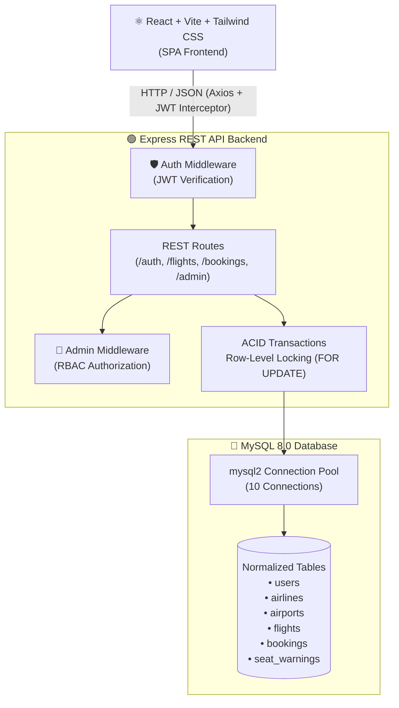
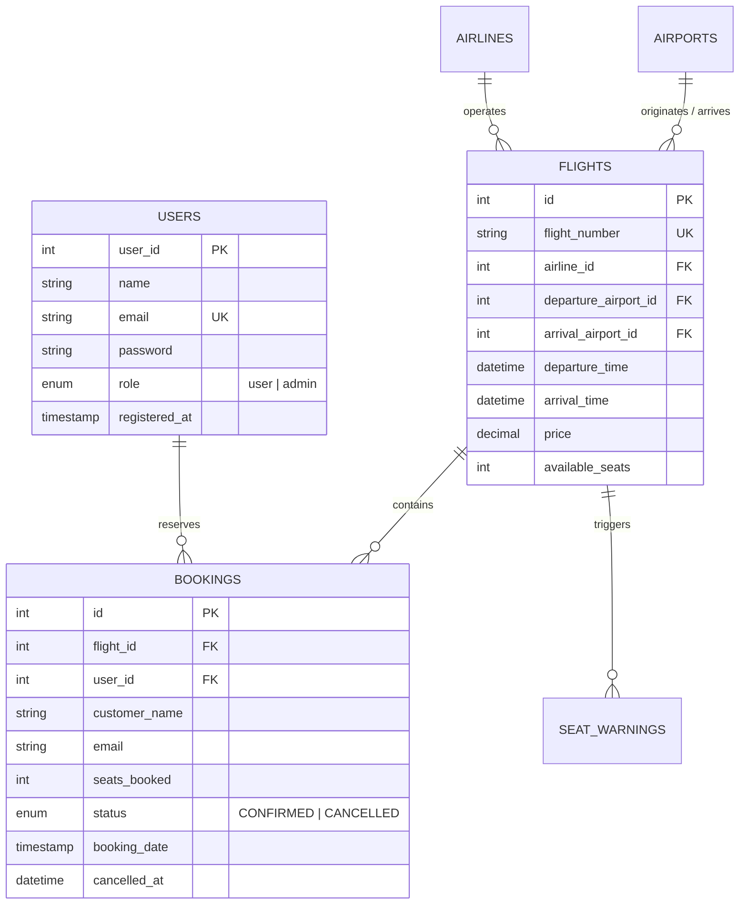

# ✈️ MyTrip — Full-Stack Flight Booking & Reservation System

[](https://nodejs.org/)
[](https://expressjs.com/)
[](https://react.dev/)
[](https://tailwindcss.com/)
[](https://www.mysql.com/)
[](https://jwt.io/)

A production-grade, full-stack flight reservation platform engineered with **React, Node.js, Express, and MySQL**. Designed with an emphasis on **backend architecture, database concurrency handling (`FOR UPDATE` row-locking), role-based access control (RBAC), ACID transactions, and soft-cancellation audit trails**.

---

## 🏛️ System Architecture



---

## 💡 Key Engineering Highlights (SDE Focus)

### 1. Concurrency Control & Race Condition Prevention
* **Problem**: In high-traffic flight booking systems, two users attempting to book the final remaining seat at the exact same millisecond can trigger a race condition, leading to overbooking (negative inventory).
* **Solution**: Implemented **Pessimistic Row-Level Locking** using MySQL's `SELECT ... FOR UPDATE` inside an isolated database transaction (`BEGIN TRANSACTION ... COMMIT`).
* **Implementation**: The target flight row is locked for writes until seat validation, user booking creation, and seat decrement queries execute atomically. On failure, the transaction executes `ROLLBACK`, guaranteeing zero data corruption.

### 2. Audit-Preserving Soft Cancellation vs. Hard DELETE
* **Problem**: Traditional `DELETE FROM bookings` permanently destroys financial audit trails, invoice history, and analytics metrics.
* **Solution**: Replaced hard deletion with a **State Machine Transition**:
  $$\text{Status: } \text{CONFIRMED} \longrightarrow \text{CANCELLED}$$
* **Implementation**: The booking record is permanently preserved with a `cancelled_at` timestamp. Seats are atomically restored back to the `flights` inventory table within a transaction, and idempotency checks prevent double-cancellations.

### 3. Stateless Authentication & Role-Based Access Control (RBAC)
* **Passwords**: Irreversibly hashed using **Bcrypt** with 10 salt rounds before database persistence.
* **Tokens**: Stateless **JSON Web Tokens (JWT)** carrying `{ userId, role }` payloads with 24-hour expiration.
* **Interceptors**: React frontend leverages an **Axios Request Interceptor** to automatically inject the Bearer token into headers without redundant boilerplate.
* **RBAC**: Multi-tier route protection:
  * Public: Flight search and autocomplete.
  * Authenticated: Reservation creation, cancellation, and personal history.
  * Admin-Only (`requireAdmin`): Revenue analytics, master booking ledger, and flight schedule management.

### 4. Database Normalization & Schema Design (3NF)
* Decomposed airports and airline carriers into normalized lookup tables (`airports`, `airlines`) to eliminate data redundancy.
* Added `CHECK (available_seats >= 0)` and `CHECK (price > 0)` constraints for integrity.
* Implemented MySQL Trigger (`after_seat_update`) automatically logging critical low-seat thresholds into an audit table (`seat_warnings`).

---

## 🗄️ Database Entity-Relationship (ER) Overview



---

## 🔌 REST API Endpoints

### 🔐 Authentication (`/api/auth`)
| Method | Endpoint | Description | Auth Required |
|---|---|---|---|
| `POST` | `/api/auth/register` | Register new user (password hashed via Bcrypt) | No |
| `POST` | `/api/auth/login` | Authenticate user & issue signed JWT | No |

### ✈️ Flights & Public (`/api`)
| Method | Endpoint | Description | Auth Required |
|---|---|---|---|
| `POST` | `/api/search` | Search flights by origin, destination & date | No |
| `POST` | `/api/book` | Create reservation with row-locking transaction | Yes (User) |
| `POST` | `/api/cancel` | Soft-cancel booking and return seats to flight | Yes (User / Admin) |
| `GET` | `/api/history` | Retrieve personal authenticated booking ledger | Yes (User) |

### 👑 Admin Operations (`/api/admin`)
| Method | Endpoint | Description | Auth Required |
|---|---|---|---|
| `GET` | `/api/admin/stats` | Aggregated revenue, booking count & analytics | Yes (Admin) |
| `GET` | `/api/admin/bookings` | View master booking ledger across all users | Yes (Admin) |
| `POST` | `/api/admin/flights` | Schedule a new dynamic flight route | Yes (Admin) |
| `PATCH` | `/api/admin/flights/:id` | Adjust flight pricing or available seats | Yes (Admin) |

---

## 💻 Tech Stack

* **Frontend:** React (Vite), Tailwind CSS v4, Axios, Lucide React Icons.
* **Backend:** Node.js (ES Modules), Express.js, MySQL2 (Connection Pool).
* **Security:** JSON Web Tokens (`jsonwebtoken`), Bcrypt (`bcryptjs`), CORS, Dotenv.
* **Database:** MySQL 8.0+.

---

## 🚀 Local Installation & Setup

### 1. Prerequisites
* **Node.js** (v18+)
* **MySQL Server** (Running locally or via XAMPP)

### 2. Database Initialization
1. Open MySQL Workbench or your terminal.
2. Run the provided schema script [`flight_booking_db.sql`](./flight_booking_db.sql) to set up tables, triggers, and the 25+ flight seed dataset:
```sql
SOURCE path/to/flight_booking_db.sql;
```

### 3. Backend Setup
1. Open your terminal in the project root:
```bash
npm install
```
2. Create/verify the `.env` file in the root directory:
```env
DB_HOST=localhost
DB_USER=root
DB_PASS=your_mysql_password
DB_NAME=flight_booking_db
JWT_SECRET=your_super_secret_jwt_key_2025
JWT_EXPIRES_IN=24h
PORT=5000
```
3. Start the Express server:
```bash
node server.js
# Server running on http://localhost:5000
```

### 4. Frontend Setup
1. Open a new terminal and navigate to `frontend`:
```bash
cd frontend
npm install
npm run dev
# Vite client running on http://localhost:5173
```
2. Open `http://localhost:5173` in your browser.

---

## 🎯 SDE Interview Discussion Points

### Q: Why did you use `SELECT ... FOR UPDATE` instead of regular queries?
> **Answer:** *"A standard SELECT followed by an UPDATE introduces a race condition under concurrent load. Two users checking seat availability simultaneously will both see seats remaining and submit orders, resulting in negative inventory. `FOR UPDATE` implements pessimistic row-locking on the flight record within an InnoDB transaction. Any competing transaction is queued until the first transaction commits or rolls back, guaranteeing ACID consistency."*

### Q: Why soft-delete bookings instead of dropping rows?
> **Answer:** *"In production fintech and reservation systems, hard deletions violate auditability and financial reporting requirements. If a customer demands a refund or an auditor requests transaction history, deleted records cause irreparable data loss. I designed the schema around state transitions (`CONFIRMED` to `CANCELLED`) with timestamps (`cancelled_at`), restoring seat inventory while preserving the audit trail."*

### Q: Why JWT over traditional server-side sessions?
> **Answer:** *"JWT provides stateless, decentralized authentication. The server signs the user payload with a cryptographic secret, allowing authorization checks without querying the database for session records on every request. This keeps the backend horizontally scalable and API-first."*
